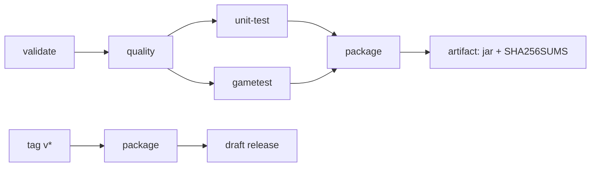

# Test & CI Design Plan — Inf

Status: implemented in this branch (Phases 1–4). Phase 5 remains optional.
Baseline: `main` at `4d2914f` (v0.2.0), verified 2026-11-25.
Scope: test architecture for the forge loop, plus the GitHub Actions CI that runs it.

## 1. Summary of the proposal

- Keep the existing pure-Java JUnit suite as the fast tier and grow it; it already
  runs without bootstrapping Minecraft.
- Add a headless **GameTest** tier (`./gradlew runGameTestServer`) for everything
  that needs real registries, item components, block entities, menus, recipes and
  advancements.
- Add a **packaging check** that inspects the built jar.
- Add CI with a small, mirrored structure: `validate → compile → unit ∥ gametest → package`,
  plus reusable `package.yml`, tag-driven `release.yml`, scheduled `codeql.yml` and
  `audit.yml`.
- Make five small production changes so the behaviour above is testable without
  fighting randomness (deterministic strike overload, view-model extraction,
  advancement id constants, menu-transfer rules, a `gametest` source set).

Target outcome: a PR gets compile + unit + GameTest + jar verification in one
workflow, warm in roughly 8–12 minutes, cold in roughly 20–30 minutes.

## 2. Baseline (verified on this machine)

| Item | State |
|---|---|
| `./gradlew test` | Passes; full rerun 5 s warm. |
| Tests | 40 tests in 11 classes on main; this branch raises the suite to 104 JUnit methods plus 17 GameTests. |
| `runGameTestServer` task | Exists (ModDevGradle run `gameTestServer`, namespace `inf`), but zero GameTests. A GameTest server with no tests fails by design. |
| `.github/` | Does not exist. No CI at all. |
| JDK | Project toolchain is 21; the machine's default `java` is 17 and Gradle provisions 21 (~/.gradle/jdks). |
| NeoForm cache | `~/.gradle/caches/neoformruntime`: artifacts 85 MB + intermediates 211 MB + client assets 800 MB. `modules-2` 206 MB. |
| Jar | `build/libs/inf-0.2.0.jar` contains `META-INF/neoforge.mods.toml`, 19 advancements, both lang files. |

Existing test inventory:

| Class | Tests | Covers |
|---|---:|---|
| `ForgeMathTest` | 12 | break chance growth/cap, gain range, rates sum, strike bands, frenzy |
| `WeaponStatsTableTest` | 5 | tier endpoints, dagger/scythe/pickaxe specials, monotonic damage |
| `HarvestRulesTest` | 4 | harvest level mapping, diamond/iron gating |
| `FrenzyStateTest` | 3 | charge, per-kind isolation, activation reset |
| `WeaponSettlementTest` | 3 | bank preconditions |
| `ForgeMenuRulesTest` | 3 | menu validity/distance |
| `WeaponTierTest` | 3 | thresholds |
| `ForgeTimingTest` | 2 | cooldown |
| `HammerDurabilityTest` | 2 | durability floor |
| `BalanceSimulationTest` | 2 | balance bands, risk monotonicity |
| `ForgeBalanceConfigTest` | 1 | factory argument order |

## 3. Test layers

### Layer 0 — JUnit, pure JVM (no Minecraft bootstrap)

Runs in seconds; this is the tier that should carry the majority of assertions.

**Exist today (keep):** the 40 tests above.

**Add (new or extended):**

1. `ForgeRatesTest` — pin the derived bands exactly:
   - `damageChance = (1 - break) * 0.08`, `greatChance = (1 - break - damage) * 0.15`,
     `success = remainder`, over a sweep of `(value, strikes)`.
   - All four chances stay in `[0, 1]`; the four sum to 1 within 1e-12.
   - Frenzy fixes 0 / 0 / 0.75 / 0.25.
   - Success chance decreases as break chance rises (monotonicity).
2. `ForgeMathTest` — boundary and invariants:
   - Roll exactly at `breakChance` is DAMAGE (BREAK uses strict `<`).
   - Roll exactly at `break+damage` is GREAT; exactly at `break+damage+great` is SUCCESS.
   - `gainRoll` clamps at 0 and 99; negative and >99 rolls.
   - DAMAGE loss is at least 1 and never exceeds the current value.
   - GREAT gain is exactly double the rolled gain.
   - Every non-BREAK outcome increments strikes exactly once; BREAK does not.
   - `valueGain` respects `minGain` even with `baseGain = 0`.
   - Whole-input-space sweep: no exception, invariants hold for every roll/gain pair.
3. `FrenzyStateTest` — extend:
   - While `ready`, further completions change nothing.
   - Progress is tracked independently for every kind (exhaustive, not just sword/axe).
   - `activated()` clears every kind and `ready`.
   - `required = 1` charges on the first completion.
4. `FrenzyStateCodecTest` — new, pure DFU:
   - JSON round-trip for every kind and both ready flags.
   - Missing optional fields default to `{}` / `false`.
   - Unknown kind id fails to parse.
5. `BladeDataCodecTest` — new:
   - Persistent codec JSON round-trip.
   - Missing optional fields default to 0 / 0 / 0L.
   - Network stream codec round-trip over an `Unpooled` buffer.
   - Unknown kind id is an error in both codecs.
6. `WeaponStatsTableTest` — extend:
   - Every one of the 30 kind×tier combinations is defined.
   - Mining speed/harvest are zero for non-tool kinds and monotonic for pickaxe/axe.
   - Sweep is zero for non-sweeping kinds; reach is negative only for dagger and
     positive only for scythe.
   - No attack-speed modifier is positive.
   - Harvest level never exceeds 4.
7. `WeaponKindTest` — new: `byId` round-trips every kind; unknown throws; translation
   keys are stable strings.
8. `WeaponTierTest` — extend: thresholds strictly increasing; `forValue(min-1)` for
   every tier; `forValue` never skips a tier.
9. `HammerMathTest` / `ForgeTimingTest` — extend:
   - Remaining durability clamps at 0 for over-use; `canStrike` false when damage
     exceeds max.
   - Zero or negative cooldown always allows; a last-strike time in the future blocks.
10. `BalanceSimulationTest` — extend:
    - Same seed → identical report.
    - Higher risk lowers the legendary rate across several seeds, not just seed 42.
    - Extreme configs terminate: `maxRisk = 1.0` breaks on the first strike;
      zero gain produces no progress.
    - Do not add wall-clock assertions (flaky on shared runners).
11. `ForgeViewModelTest` — new, after the refactor in §4.2: every `ContainerData`
    index, permille rounding (half-up), tier ordinal, gain min/max, frenzy fields,
    empty-blade view, and the fact that `RISK_PERMILLE` and `BREAK_PERMILLE` report
    the same value.
12. `ForgeMenuTransferTest` — new, after the refactor in §4.4: blank → blade slot,
    hammer → hammer slot, machine → player inventory, player ↔ hotbar fallback,
    output is not insertable, no-room case leaves the stack untouched.
13. `ResourceLintTest` — new, plain filesystem/JSON (add `testImplementation gson`
    explicitly):
    - `data/inf/advancement/*.json`: 19 files; valid JSON; ids unique; every
      `parent` resolves to another `inf` advancement or a `minecraft:` id; graph is
      acyclic and single-rooted; every display title/description key exists in both
      `en_us.json` and `zh_cn.json`; every `icon.id` is an `inf:` item with a model.
    - Advancement id constants (§4.3): every constant has a file; the generated
      `kind_*` set equals `WeaponKind.values()`; the generated `tier_*` set equals
      the tiers that have nodes (all except CRUDE).
    - Recipes: all 7 JSONs parse; results are `inf:*`; shaped patterns are rectangular
      and non-empty.
    - Models: every texture reference under `assets/inf/models/**` resolves to a
      `.png` under `assets/inf/textures/**`; no item model references a `minecraft:`
      texture; every blockstate points at an existing model; the GUI texture and
      advancement background exist.
    - Lang parity: `en_us` and `zh_cn` have identical key sets and no empty values.
    - Loot tables: every `data/inf/loot_table/blocks/*.json` drops its own block id.
    - Packaging metadata: exactly one `src/main/templates/META-INF/neoforge.mods.toml`.
14. `DocsDriftTest` (optional, cheap): parse the default column of
    `docs/configuration.md` and compare it with `ForgeBalance.DEFAULT`; parse the
    node list in `docs/advancement-tree.md` and compare it with the 19 files.

### Layer 1 — GameTests (headless server)

17 tests: G1–G16 from the table plus a separate `advancements_allNineteenExist`
smoke test (counted as G17).

This tier covers everything that needs real registries or world state. Put it in a
dedicated `gametest` source set so tests do not ship in the release jar.

Scaffolding:

- `src/gametest/java/com/inf/gametest/ForgeGameTests.java`, annotated
  `@GameTestHolder(Inf.MODID)`, methods annotated
  `@GameTest(template = "platform", timeoutTicks = 200)`.
- Structure `src/main/resources/data/inf/structure/platform.nbt`: a small stone
  floor with air above (5×5×5 total: stone at y=0, air at y=1–4, DataVersion 3955
  for 1.21.1). Test cells start at y=1, on top of the floor. NeoForge 21.1.266 does
  not ship an empty/platform template (verified in the NeoForge jars and the vanilla
  1.21.1 client jar), so this file must be checked in. Generate it once with a
  `tools/gen_gametest_structure.py` script (matches the existing
  `tools/gen_assets.py` pattern).
- The optional `net.neoforged:testframework` artifact provides `@EmptyTemplate`
  and `GameTestPlayer`, but it is tied to that framework's own `@TestHolder` test
  model. It is an alternative to evaluate, not the default path here.

Tests (each invokes `ForgeService`/`ForgeMenu` directly with a mock server player
from `helper.makeMockServerPlayerInLevel()`). Multi-strike tests must respect the
4-tick strike cooldown: either idle between strikes with a `GameTestSequence`
(`helper.startSequence().thenIdle(5).thenExecute(...)`) or reset
`markStrike(Long.MIN_VALUE)` between calls. A single `@GameTest` method otherwise
runs within one tick.

Test list:

| ID | Test | Assertion |
|---|---|---|
| G1 | `strike_success_updatesBladeAndWearsHammer` | value rises, strikes = 1, hammer damage +1 |
| G2 | `strike_break_clearsBlade_resetsFrenzy_andWearsHammer` | blade slot empty, frenzy 0, hammer still wears |
| G3 | `strike_damage_losesTenPercent_andCountsStrike` | value = 90 from 100, strikes = 1 |
| G4 | `hammer_lastDurability_breaksAndEmptiesSlot` | hammer slot empty at damage 127/128 |
| G5 | `stop_banksWeapon_withTierNameRarityAndAttributes` | output is the forged kind, `ITEM_NAME`, EPIC rarity, ATTACK_DAMAGE 11 at value 1000 |
| G6 | `stop_pickaxe_toolComponentGatesDrops` | crude denies iron+diamond; legendary denies neither; mining speed 15 |
| G7 | `stop_rejected_whenOutputOccupied_orValueZero` | returns false, blade untouched |
| G8 | `frenzy_grantThreeUnbreakableStrikes_andConsume` | 3 strikes with roll 0.0 never break; counter hits 0 |
| G9 | `frenzy_activationRequiresReadyStateAndValue` | not-ready or zero value → false |
| G10 | `menu_buttonDispatch_strikeStopFrenzy` | `clickMenuButton` routes ACTION_STRIKE/STOP/FRENZY |
| G11 | `menu_quickMove_routesBlanksHammersAndOutput` | shift-click fills the right slot; output only moves out |
| G12 | `blockEntity_saveLoad_roundTripsAllState` | `saveWithFullMetadata` → `BlockEntity.loadStatic` preserves inventory, frenzy, last strike |
| G13 | `forgeTable_removal_dropsContents` | `destroyBlock` spawns item entities for all occupied slots |
| G14 | `recipes_everyInfRecipeLoads` | all 7 recipe keys resolve and produce the expected item |
| G15 | `advancements_allNineteenExist_andAwardOnTriggers` | all ids resolve; `first_strike`/`first_weapon`/`tier_*`/`kind_*` flip to done |
| G16 | `knockback_suppressedForDaggerOnly` | `LivingKnockBackEvent` strength 0 with dagger in main hand, unchanged otherwise |

### Layer 2 — Packaging checks (CI, not JUnit)

- Jar exists under `build/libs/`, name matches `mod_version`.
- Contains `META-INF/neoforge.mods.toml` with the expanded version.
- Contains exactly 19 `data/inf/advancement/*.json` and both lang files.
- Contains no `com/inf/gametest/**`, no `.bbmodel`, no `src/generated/**/.cache`.

### Layer 3 — Not automated (keep manual)

The client screen (`ForgeScreen`, `ForgeButton`, tier colours, tooltips, GUI scale,
zh/en layout) stays in `docs/release-checklist.md`. GameTest is server-side; client
rendering automation (Xvfb + screenshot) is a later, optional phase and is not
assumed by this plan. The manual checklist remains the release gate for UI.

## 4. Production changes required for testability

All are behaviour-preserving.

### 4.1 Deterministic strike overload

`ForgeService.strike` currently pulls both rolls from `player.getRandom()`, so
GameTests can only assert loose invariants. Add:

```java
static boolean strike(ForgeBlockEntity be, ServerPlayer player, double outcomeRoll, int gainRoll)
```

The existing `strike(be, player)` delegates with `player.getRandom().nextDouble()`
and `nextInt(100)`. Tests then pin exact outcomes; the seed for new blades may stay
random (it does not affect the weapon's name or stats today).

### 4.2 Extract a pure view model from `ForgeData`

`ForgeData` mixes three inputs (block entity, player attachment, config) and the
`ContainerData` index contract. Extract a pure
`ForgeViewModel.from(BladeData blade, boolean frenzyReady, int frenzyProgress,
int frenzyActive, int frenzyRequired, ForgeBalance balance)` returning the 14
indices. `ForgeData` becomes the adapter that reads the block entity/player and
delegates. This makes permille rounding and index mapping unit-testable and keeps
the server→client contract in one place.

### 4.3 Advancement id constants

Introduce `ForgeAdvancements` constants (or a small `ForgeAdvancementIds` class)
for `first_strike`, `first_weapon`, `break_blade`, `damage_blade`, `great_success`,
`hammer_break`, `frenzy`, `tier_*`, `kind_*`, `all_kinds`, and use them at every
call site. `ResourceLintTest` then checks constants ↔ JSON files without parsing
Java string literals.

### 4.4 Menu transfer rules

Extract the destination decision of `ForgeMenu.quickMoveStack` into a pure
`ForgeMenuTransfer` (given item type, clicked index, slot count → target range or
none). The menu keeps the actual `moveItemStackTo` calls.

### 4.5 `gametest` source set

`build.gradle` additions:

```groovy
sourceSets {
    gametest {
        compileClasspath += sourceSets.main.output
        runtimeClasspath += sourceSets.main.output
    }
}

neoForge {
    addModdingDependenciesTo sourceSets.gametest
    mods {
        "${mod_id}" {
            sourceSet(sourceSets.main)
            sourceSet(sourceSets.gametest)
        }
    }
    runs {
        gameTestServer {
            sourceSet = sourceSets.gametest
        }
    }
}
```

`addModdingDependenciesTo` exists in ModDevGradle 2.0.148 (verified in the plugin
class files). The `gametest` source set is isolated from `main`, so its classes are
not packaged by `jar`; the structure NBT stays in `src/main/resources` because the
datapack must be available at runtime. Fallback if source-set juggling causes
trouble: put tests in `src/main/java` and add
`tasks.named('jar') { exclude 'com/inf/gametest/**' }`.

### 4.6 Coverage (JaCoCo)

Add the `jacoco` plugin and a `jacocoTestCoverageVerification` rule scoped to the
pure packages only:

- included: `com.inf.forge.*`, `com.inf.weapon.*`, `com.inf.menu.ForgeMenuRules`,
  `com.inf.menu.ForgeMenuTransfer`, `com.inf.registry.FrenzyStateCodec`,
  `com.inf.item.component.BladeData`;
- excluded: `ForgeService`, `WeaponFactory`, `WeaponAttributeApplier`,
  `WeaponToolFactory` (Minecraft-bound);
- start by publishing the report, then ratchet to 80% line / 70% branch in Phase 2.

## 5. CI design

### 5.1 Workflow tree, down to steps

```
ci.yml · push main · pull_request main · workflow_dispatch
│
├─ validate (5 min)
│  ├─ checkout                      persist-credentials: false
│  └─ gradle/actions/wrapper-validation
│
├─ quality (25 min)                 needs: validate
│  ├─ checkout
│  ├─ ./.github/actions/gradle-setup
│  ├─ ./gradlew compileJava compileTestJava
│  ├─ [Phase 2] ./gradlew spotlessCheck
│  └─ on failure: upload build/reports/problems
│
├─ unit-test (20 min)               needs: quality
│  ├─ checkout
│  ├─ ./.github/actions/gradle-setup
│  ├─ ./gradlew test                [Phase 2: check, adds JaCoCo verification]
│  ├─ always: summarize build/test-results/test/*.xml → $GITHUB_STEP_SUMMARY
│  └─ always: upload build/test-results/test + build/reports/tests/test
│
├─ gametest (35 min)                needs: quality        [enable in Phase 3]
│  ├─ checkout
│  ├─ ./.github/actions/gradle-setup
│  ├─ mkdir -p run && printf 'eula=true\n' > run/eula.txt
│  ├─ ./gradlew runGameTestServer
│  └─ on failure: upload run/logs + run/crash-reports
│
└─ package (called workflow)        needs: [unit-test, gametest]
   └─ package.yml
      ├─ checkout
      ├─ ./.github/actions/gradle-setup
      ├─ ./gradlew assemble
      ├─ jar assertions: mods.toml · 19 advancements · 2 languages · no gametest/bbmodel
      ├─ sha256sum
      ├─ step summary: jar name, size, sha256
      └─ upload inf-*.jar + SHA256SUMS.txt
```

Job DAG:

```
validate ──► quality ──┬──► unit-test ──┐
                       └──► gametest  ──┴──► package ──► artifact
release.yml: tag v* ──► package ──► draft release
```

Mermaid version (renders on GitHub):



### 5.2 Job contracts

| Job | Needs | Timeout | Runner | Command | Produces | Blocks merge |
|---|---|---|---:|---|---|---|
| `validate` | — | 5 | ubuntu-latest | wrapper validation | — | yes |
| `quality` | validate | 25 | ubuntu-latest | `compileJava compileTestJava` (+`spotlessCheck` later) | problems report on failure | yes |
| `unit-test` | quality | 20 | ubuntu-latest | `test` (then `check`) | JUnit XML/HTML (+ JaCoCo later) | yes |
| `gametest` | quality | 35 | ubuntu-latest | `runGameTestServer` | logs on failure | yes |
| `package` | unit-test, gametest | 25 | ubuntu-latest | `assemble` + jar checks | `inf-*.jar`, `SHA256SUMS.txt` | optional |
| `release/package` | tag `v*` | 25 | ubuntu-latest | same reusable `package.yml` | same artifact | release |
| `release/publish` | package | 10 | ubuntu-latest | tag/version guard + release | draft release | release |
| `codeql/analyze` | — | 30 | ubuntu-latest | `compileJava` under CodeQL | SARIF | advisory |
| `audit/dependency-review` | — | 10 | ubuntu-latest | dependency review | PR comment | advisory |

### 5.3 Step design and rationale

#### Shared setup: `.github/actions/gradle-setup`

A local composite action used by every Gradle job, so the JDK version, action SHAs and
cache keys exist in one place. It assumes the calling job has already checked out the
repository (the cache key hashes `gradle.properties`):

```yaml
# .github/actions/gradle-setup/action.yml
name: Gradle setup
description: JDK 21 (Temurin), Gradle caches, and the NeoForm artifact cache.

inputs:
  neoform-cache-key:
    description: Cache key for the NeoForm artifacts.
    required: true

runs:
  using: composite
  steps:
    - name: Set up JDK 21
      uses: actions/setup-java@d1374f8ac74474200d16ef8ecee22c7ae7a51880  # v6.3.0
      with:
        distribution: temurin
        java-version: '21'
    - name: Set up Gradle caches
      uses: gradle/actions/setup-gradle@8da46b539cd8fe6ab27ca75128919a18d757604c  # v6.4.1
      with:
        cache-read-only: ${{ github.event_name == 'pull_request' }}
    - name: Cache NeoForm artifacts
      uses: actions/cache@55cc8345863c7cc4c66a329aec7e433d2d1c52a9  # v6.1.0
      with:
        path: |
          ~/.gradle/caches/neoformruntime/artifacts
          ~/.gradle/caches/neoformruntime/intermediate_results
        key: ${{ inputs.neoform-cache-key }}
        restore-keys: |
          neoform-${{ runner.os }}-
```

Why a composite action: four jobs need the same five setup decisions; a composite
prevents drift when the JDK, Gradle action, or cache path changes. `cache-read-only`
keeps PR runs from writing caches, so only `main` refreshes them (also the only
option for fork PRs, which cannot write caches).

#### `validate`

- `actions/checkout` with `persist-credentials: false`: CI never pushes, so the
  token should not be left in `.git/config`.
- Wrapper validation only; it is seconds and catches a tampered
  `gradle-wrapper.jar` before any Gradle process runs.
- Optional: `actionlint` (workflow-expression and shell lint). It needs a pinned
  action or a downloaded binary; add it only if workflow edits are frequent.

#### `quality`

- Compile `main` and `test` sources before the fan-out. A type error fails here
  once, on the shortest path, instead of inside both unit and GameTest jobs.
- `compileTestJava` is included because the test sources are part of the change
  surface even when only `main` is edited (renames, signatures).
- In Phase 2, add `spotlessCheck` with `palantir-java-format`; land it together
  with a one-time `spotlessApply` commit so the gate is green from the first run.
- On failure, upload `build/reports/problems/` — Gradle's problems report contains
  the configuration-cache and plugin failures that the console truncates.

#### `unit-test`

- Phase 1 runs `test`. Phase 2 switches to `check`, which adds
  `jacocoTestCoverageVerification` without changing the command shape.
- No `--rerun-tasks`: Gradle's up-to-date checks and the build cache are the
  desired behaviour; forcing reruns makes every job cold.
- `if: always()` uploads the XML and HTML reports so a failed job still carries
  machine-readable evidence.
- The summary step parses `build/test-results/test/*.xml` with Python's stdlib
  `xml.etree` and appends a small table to `$GITHUB_STEP_SUMMARY`; it tolerates an
  empty directory (compile failed before tests) by printing "no results".
- Phase 2 uploads `build/reports/jacoco/test/jacocoTestReport.xml` and the HTML
  report as `coverage-<sha>`; the XML is the file to parse for trends later.

#### `gametest`

- The `run/` directory is gitignored and absent on a fresh runner; create it and
  write `run/eula.txt` defensively. GameTestServer normally bypasses the EULA in a
  dev launch, but the file is harmless and removes a class of first-run failures.
- The exit code is the gate: a failing required GameTest makes the Gradle run fail.
  Do not scrape logs for verdicts.
- Upload `run/logs` and `run/crash-reports` on failure only: logs are multi-MB and
  are only useful when something went wrong. `if-no-files-found: ignore` keeps a
  missing directory from masking the real failure.
- `timeout-minutes: 35` covers a cold decompile, server bootstrap and 16 tests;
  each test also carries its own `timeoutTicks` (200) so a hung test fails itself.
- Enable this job only after the first GameTest exists: an empty GameTestServer
  run fails by design.

#### `package`

- A reusable workflow (`workflow_call`) rather than an inline job, so `release.yml`
  runs exactly the same build and verification path as CI.
- `assemble`, not `build`: tests already ran in the gate jobs; `build` would repeat
  them. `assemble` still produces the jar and runs resource processing.
- Jar assertions are plain shell (`jar tf` + `grep`), no extra action:
  - `META-INF/neoforge.mods.toml` exists (version expansion ran);
  - exactly 19 `data/inf/advancement/*.json`;
  - both `assets/inf/lang/en_us.json` and `zh_cn.json`;
  - no `com/inf/gametest/**` (source set stayed out of the jar);
  - no `.bbmodel` (BlockBench sources excluded by `sourceSets.main.resources`).
- `sha256sum` runs in the same job as the jar, so checksums cannot drift from the
  artifact they describe.
- Artifact name includes `github.sha`; `if-no-files-found: error` turns a version
  or archive-name regression into a failing job instead of a silent empty upload.

### 5.4 Commands and flags

| Flag | Why |
|---|---|
| `--no-daemon` | ephemeral runner; avoids daemon start/leak and stale daemon state |
| `--stacktrace` | actionable failure without reproducing locally |
| `--console=plain` | no ANSI/progress rewriting in CI logs |
| `-Dorg.gradle.jvmargs=-Xmx3G` | already in `gradle.properties`; runner has 16 GB |
| no `--rerun-tasks` | up-to-date checks and the build cache are the design |
| no `--offline` | cold runners need dependency resolution |

`gradle.properties` already enables the configuration cache and parallel builds.
Each job starts with a cold configuration cache (it lives in the project's
`.gradle/`, which is not cached), but a job that invokes Gradle more than once
(e.g. future split steps) reuses it within the job.

### 5.5 Cache design

| Cache | Path | Key | Size | Written by |
|---|---|---|---|---|
| Gradle modules + build cache | managed by `setup-gradle` | hash of build files | ~200–400 MB | `setup-gradle` |
| NeoForm artifacts | `neoformruntime/artifacts` + `intermediate_results` | `neoform-<os>-<hash(gradle.properties)>` | ~300 MB | `actions/cache` |
| Gradle wrapper distribution | managed by `setup-gradle` | wrapper properties hash | ~130 MB | `setup-gradle` |

Rules:

- **Do not cache `neoformruntime/assets`** (≈800 MB of client assets). No compile,
  unit, GameTest or packaging job needs them.
- **PR runs are cache-read-only.** Only `main` writes caches, which keeps PR runs
  from poisoning the cache and works for fork PRs where writes are forbidden.
- **Never cache `build/` or `.gradle/`.** Stale outputs defeat `assemble` checks;
  the configuration cache is path- and environment-sensitive.
- A cache miss costs one NeoForm decompile (minutes), never correctness: NFRT
  validates hashes and re-downloads what it needs.
- The NeoForm key uses `gradle.properties`, so a NeoForge or Parchment bump creates
  a new key; `restore-keys` still gets the old artifacts as a partial base.

### 5.6 Concurrency, permissions and runner

```yaml
concurrency:
  group: ci-${{ github.workflow }}-${{ github.ref }}
  cancel-in-progress: ${{ github.event_name == 'pull_request' }}
```

- PRs: a new push cancels the previous run (fast feedback, no stale queue).
- `main`: runs are not cancelled. GitHub keeps at most one running and one pending
  per group, so a rapid burst of pushes can supersede the pending run. If every
  `main` commit must produce a jar, use `group: ...-${{ github.sha }}` for `push`
  events instead.
- The reusable workflow runs inside the caller's run; it does not define its own
  concurrency group.
- Permissions: workflow-level `contents: read`; no job elevates except CodeQL
  (`security-events: write`) and release (`contents: write`). Never use
  `pull_request_target`; no secrets are available to PR jobs.
- Runner: `ubuntu-latest` (4 vCPU / 16 GB as of 2026). `-Xmx3G` leaves headroom for
  the NeoForm tool and the GameTest server.
- No OS matrix by default: the jar is OS-independent. An optional weekly
  `windows-latest` compile-only job catches path-case regressions without doubling
  PR cost.

### 5.7 Diagnostics, summaries and artifacts

| Surface | Uploaded | When | Retention |
|---|---|---|---|
| Compile problems | `build/reports/problems/` | `failure()` | 7 d |
| Unit tests | `build/test-results/test/`, `build/reports/tests/test/` | `always()` | 7 d |
| Coverage (Phase 2) | `build/reports/jacoco/test/` | `always()` | 7 d |
| GameTests | `run/logs/`, `run/crash-reports/` | `failure()` | 7 d |
| Package | `inf-*.jar`, `SHA256SUMS.txt` | success | 14 d |
| Release | same files | tag | release asset |

Step summaries:

- `unit-test`: totals from all JUnit XMLs (`tests`, `failures`, `errors`, `skipped`)
  plus a per-class line for failed classes.
- `gametest`: exit status and the artifact name; the detailed verdicts stay in
  `run/logs/latest.log` to avoid brittle log parsing.
- `package`: jar name, byte size and sha256.

Artifact names include `${{ github.sha }}` so reruns and multiple jobs do not
collide; `retention-days` is deliberately short because the jar is reproducible
from the commit.

### 5.8 Branch protection and check names

- Required checks use the job's `name:` display string, not the job id:
  `Validate wrapper`, `Compile`, `Unit tests`, `Game tests`.
- The reusable package check appears as `Package / Jar` (caller job name / called
  job name). Confirm the exact string on the first run before adding it to the
  protection rule.
- Keep the `name:` values stable once protection is configured; renaming a job
  silently detaches it from the required-check list.
- Do **not** add `paths-ignore` to a workflow that owns required checks. A skipped
  run can leave a required check pending, which blocks the PR forever. Docs-only
  PRs are cheap enough to run the full gate on this repository.
- `workflow_dispatch` is for maintainers; it is not a required check.

### 5.9 Scheduled and release workflows

- `codeql.yml`: `java-kotlin` with `build-mode: manual` around `./gradlew
  compileJava` (ModDevGradle needs its modding classpath, so autobuild is
  unreliable), plus the `actions` language for workflow-injection checks. Reuses
  the same JDK/cache setup. Weekly rescan of unchanged code.
- `audit.yml`: `actions/dependency-review-action` on PRs (fail on high). OSV
  scanning needs a `gradle.lockfile`; enabling Gradle dependency locking is a
  separate decision (noisy with ModDevGradle) and is optional.
- `release.yml`: tag `v*` → reusable `package.yml` → tag/`mod_version` guard →
  draft GitHub Release with jar and checksums (draft, matching the reference
  repository's release flow). Modrinth/CurseForge publishing is opt-in via secrets
  and out of scope here.
- `.github/dependabot.yml`: weekly `gradle` and `github-actions` updates. The
  NeoForge version lives in `gradle.properties`, which Dependabot does not manage;
  bump it manually.

### 5.10 Cost budget and acceptance criteria

Estimated wall-clock (4-vCPU runner):

| Job | Cold (no caches) | Warm |
|---|---:|---:|
| validate | < 15 s | < 15 s |
| quality | 8–12 min | 1–2 min |
| unit-test | 6–9 min | 30–60 s |
| gametest | 8–12 min | 2–4 min |
| package | 3–5 min | 1–2 min |
| **PR total** | **20–35 min** | **8–12 min** |

Acceptance criteria for the workflow itself (verify on the first PRs):

- [ ] A failing unit test marks `unit-test` red and the XML artifact contains the
      failure.
- [ ] A failing GameTest marks `gametest` red and `run/logs` is uploaded.
- [ ] A compile error fails `quality` and unit/gametest are skipped.
- [ ] A PR from a fork restores caches read-only and needs no secrets.
- [ ] A docs-only PR passes the full gate (no required check is skipped).
- [ ] A `main` push produces `inf-<version>.jar` and `SHA256SUMS.txt`.
- [ ] A `v*` tag produces a draft release whose jar passes the same checks.
- [ ] Two quick pushes to a PR leave only the newer run.
- [ ] The Gradle wrapper jar is validated before any Gradle process starts.

## 6. Gates and targets

| Gate | Where | Blocks merge |
|---|---|---|
| Wrapper validation | validate | yes |
| Compile (main + test) | quality | yes |
| 104 JUnit tests | unit-test | yes |
| JaCoCo 80% line / 70% branch on pure packages (Phase 2) | unit-test | yes (ratchet) |
| 17 GameTests | gametest | yes |
| Jar content checks | package | yes for releases; optional for PRs |
| CodeQL / dependency review | scheduled / PR | advisory first, then required |

## 7. Rollout

- **Phase 1 — CI skeleton.** Done: `ci.yml` (validate/quality/unit-test/package),
  reusable `package.yml`, composite `gradle-setup`.
- **Phase 2 — unit expansion.** Done: 104 JUnit methods across 21 test classes,
  the §4.1–4.4 refactors, JaCoCo report and an 80% line rule on the pure packages.
  Spotless/`palantir-java-format` is deliberately deferred; it is a standalone
  formatting change, not a behaviour change.
- **Phase 3 — GameTests.** Done: `gametest` source set, generated platform NBT,
  G1–G17, `gametest` CI job, deterministic strike overload.
- **Phase 4 — release & security.** Done: `release.yml`, `codeql.yml`, `audit.yml`,
  `dependabot.yml`. Branch protection still has to be enabled in the GitHub UI.
- **Phase 5 — optional.** Nightly Xvfb client smoke; Gradle dependency locking +
  OSV; NeoForge `testframework` if GameTest boilerplate becomes painful.

## 8. Risks and mitigations

| Risk | Mitigation |
|---|---|
| GameTests flake on random rolls | deterministic overload; assert invariants when randomness remains; fixed platform template; explicit `timeoutTicks` |
| Cold NeoForm decompile dominates CI | cache `artifacts` + `intermediate_results` with a stable key; exclude the 800 MB client-assets subtree |
| Configuration cache misbehaves under CI | keep `--no-daemon`; add `--no-configuration-cache` to CI commands only if it breaks; local behaviour unchanged |
| GameTest source set confuses ModDevGradle | fallback: tests in `src/main/java` + `jar { exclude 'com/inf/gametest/**' }` |
| Empty platform template missing | must be added; verified not shipped by NeoForge 21.1.266 or vanilla 1.21.1 |
| Pinned action SHAs rot | Dependabot `github-actions`; review quarterly |
| Coverage gate churn while packages move | rules are scoped to a named package list; update the list with the refactors |
| 19 advancement files and code drift | advancement constants + `ResourceLintTest` + G15 |

## Appendix A — draft workflows (not committed)

All action SHAs were resolved on 2026-11-25; the `# vX.Y.Z` comments are for
reviewers. If an action is bumped, change the SHA and the comment together.

### `.github/actions/gradle-setup/action.yml`

```yaml
name: Gradle setup
description: JDK 21, Gradle caches and NeoForm artifacts for the Inf build.

inputs:
  neoform-cache-key:
    description: Cache key for the NeoForm artifacts.
    required: true

runs:
  using: composite
  steps:
    - name: Set up JDK 21
      uses: actions/setup-java@d1374f8ac74474200d16ef8ecee22c7ae7a51880  # v6.3.0
      with:
        distribution: temurin
        java-version: '21'

    - name: Set up Gradle
      uses: gradle/actions/setup-gradle@8da46b539cd8fe6ab27ca75128919a18d757604c  # v6.4.1
      with:
        cache-read-only: ${{ github.event_name == 'pull_request' }}

    - name: Cache NeoForm artifacts
      uses: actions/cache@55cc8345863c7cc4c66a329aec7e433d2d1c52a9  # v6.1.0
      with:
        path: |
          ~/.gradle/caches/neoformruntime/artifacts
          ~/.gradle/caches/neoformruntime/intermediate_results
        key: ${{ inputs.neoform-cache-key }}
        restore-keys: |
          neoform-${{ runner.os }}-
```

### `.github/workflows/ci.yml`

Phase 1 copies this file without the `gametest` job and with
`package.needs: [unit-test]`. Phase 3 adds the `gametest` job and extends `needs`.

```yaml
name: CI

on:
  push:
    branches: [main]
  pull_request:
    branches: [main]
  workflow_dispatch:

concurrency:
  group: ci-${{ github.workflow }}-${{ github.ref }}
  cancel-in-progress: ${{ github.event_name == 'pull_request' }}

permissions:
  contents: read

jobs:
  validate:
    name: Validate wrapper
    runs-on: ubuntu-latest
    timeout-minutes: 5
    steps:
      - uses: actions/checkout@3d3c42e5aac5ba805825da76410c181273ba90b1  # v7.0.1
        with:
          persist-credentials: false
      - uses: gradle/actions/wrapper-validation@8da46b539cd8fe6ab27ca75128919a18d757604c  # v6.4.1

  quality:
    name: Compile
    needs: validate
    runs-on: ubuntu-latest
    timeout-minutes: 25
    steps:
      - uses: actions/checkout@3d3c42e5aac5ba805825da76410c181273ba90b1  # v7.0.1
        with:
          persist-credentials: false
      - uses: ./.github/actions/gradle-setup
        with:
          neoform-cache-key: neoform-${{ runner.os }}-${{ hashFiles('gradle.properties') }}
      - name: Compile main and test sources
        run: ./gradlew --no-daemon --stacktrace --console=plain compileJava compileTestJava
      # Phase 2: formatting gate, landed together with a one-time spotlessApply commit.
      # - name: Formatting
      #   run: ./gradlew --no-daemon --stacktrace --console=plain spotlessCheck
      - name: Upload Gradle problems report
        if: failure()
        uses: actions/upload-artifact@cf430e030ddbb5b0abf93d22962f4752f3646cd9  # v7.0.2
        with:
          name: gradle-problems-${{ github.sha }}
          path: build/reports/problems
          if-no-files-found: ignore
          retention-days: 7

  unit-test:
    name: Unit tests
    needs: quality
    runs-on: ubuntu-latest
    timeout-minutes: 20
    steps:
      - uses: actions/checkout@3d3c42e5aac5ba805825da76410c181273ba90b1  # v7.0.1
        with:
          persist-credentials: false
      - uses: ./.github/actions/gradle-setup
        with:
          neoform-cache-key: neoform-${{ runner.os }}-${{ hashFiles('gradle.properties') }}
      - name: Test
        run: ./gradlew --no-daemon --stacktrace --console=plain test
        # Phase 2: replace `test` with `check` to add jacocoTestCoverageVerification.
      - name: Summarize test results
        if: always()
        shell: bash
        run: |
          set -euo pipefail
          python3 - <<'PY' >> "$GITHUB_STEP_SUMMARY"
          import glob
          import xml.etree.ElementTree as ET

          tests = failures = errors = skipped = 0
          rows = []
          for path in sorted(glob.glob("build/test-results/test/*.xml")):
              root = ET.parse(path).getroot()
              t = int(root.get("tests", 0))
              f = int(root.get("failures", 0))
              e = int(root.get("errors", 0))
              s = int(root.get("skipped", 0))
              tests += t
              failures += f
              errors += e
              skipped += s
              if f or e:
                  rows.append(f"| {root.get('name', '?')} | {t} | {f} | {e} |")

          print("## Unit tests")
          print()
          print(f"{tests} tests, {failures} failures, {errors} errors, {skipped} skipped")
          if rows:
              print()
              print("| Class | Tests | Failures | Errors |")
              print("|---|---:|---:|---:|")
              print("\n".join(rows))
          PY
      - name: Upload test reports
        if: always()
        uses: actions/upload-artifact@cf430e030ddbb5b0abf93d22962f4752f3646cd9  # v7.0.2
        with:
          name: unit-test-reports-${{ github.sha }}
          path: |
            build/test-results/test
            build/reports/tests/test
          if-no-files-found: ignore
          retention-days: 7

  gametest:
    name: Game tests
    needs: quality
    runs-on: ubuntu-latest
    # Phase 3: add this job after the first GameTest exists.
    timeout-minutes: 35
    steps:
      - uses: actions/checkout@3d3c42e5aac5ba805825da76410c181273ba90b1  # v7.0.1
        with:
          persist-credentials: false
      - uses: ./.github/actions/gradle-setup
        with:
          neoform-cache-key: neoform-${{ runner.os }}-${{ hashFiles('gradle.properties') }}
      - name: Prepare run directory
        run: |
          mkdir -p run
          printf 'eula=true\n' > run/eula.txt
      - name: Run GameTests
        run: ./gradlew --no-daemon --stacktrace --console=plain runGameTestServer
      - name: Upload GameTest logs
        if: failure()
        uses: actions/upload-artifact@cf430e030ddbb5b0abf93d22962f4752f3646cd9  # v7.0.2
        with:
          name: gametest-logs-${{ github.sha }}
          path: |
            run/logs
            run/crash-reports
          if-no-files-found: ignore
          retention-days: 7

  package:
    name: Package
    needs: [unit-test, gametest]
    permissions:
      contents: read
    uses: ./.github/workflows/package.yml
```

### `.github/workflows/package.yml`

```yaml
name: Package

on:
  workflow_call:
    inputs:
      upload_artifacts:
        description: Upload the built jar as a workflow artifact.
        required: false
        type: boolean
        default: true

permissions:
  contents: read

jobs:
  jar:
    name: Jar
    runs-on: ubuntu-latest
    timeout-minutes: 25
    steps:
      - uses: actions/checkout@3d3c42e5aac5ba805825da76410c181273ba90b1  # v7.0.1
        with:
          persist-credentials: false
      - uses: ./.github/actions/gradle-setup
        with:
          neoform-cache-key: neoform-${{ runner.os }}-${{ hashFiles('gradle.properties') }}
      - name: Assemble
        run: ./gradlew --no-daemon --stacktrace --console=plain assemble
      - name: Verify jar contents
        shell: bash
        run: |
          set -euo pipefail
          JAR=$(ls build/libs/inf-*.jar)
          test -n "$JAR"
          echo "Jar: $JAR"

          jar tf "$JAR" | grep -qx 'META-INF/neoforge.mods.toml'
          test "$(jar tf "$JAR" | grep -c '^data/inf/advancement/.*\.json$')" -eq 19
          jar tf "$JAR" | grep -qx 'assets/inf/lang/en_us.json'
          jar tf "$JAR" | grep -qx 'assets/inf/lang/zh_cn.json'

          if jar tf "$JAR" | grep -q '^com/inf/gametest/'; then
            echo "gametest classes leaked into the release jar"
            exit 1
          fi
          if jar tf "$JAR" | grep -q '\.bbmodel$'; then
            echo "BlockBench sources leaked into the release jar"
            exit 1
          fi

          SIZE=$(stat -c%s "$JAR")
          SHA=$(sha256sum "$JAR" | cut -d' ' -f1)
          {
            echo "## Package"
            echo
            echo "| Field | Value |"
            echo "|---|---|"
            echo "| Jar | $(basename "$JAR") |"
            echo "| Size | $SIZE bytes |"
            echo "| SHA-256 | \`$SHA\` |"
          } >> "$GITHUB_STEP_SUMMARY"
      - name: Checksums
        run: cd build/libs && sha256sum inf-*.jar > SHA256SUMS.txt
      - name: Upload jar
        if: inputs.upload_artifacts
        uses: actions/upload-artifact@cf430e030ddbb5b0abf93d22962f4752f3646cd9  # v7.0.2
        with:
          name: inf-${{ github.sha }}
          path: |
            build/libs/inf-*.jar
            build/libs/SHA256SUMS.txt
          if-no-files-found: error
          retention-days: 14
```

### `.github/workflows/release.yml`

```yaml
name: Release

on:
  push:
    tags: ["v*"]

permissions:
  contents: write

jobs:
  package:
    name: Build jar
    permissions:
      contents: read
    uses: ./.github/workflows/package.yml

  publish:
    name: Publish draft release
    needs: package
    runs-on: ubuntu-latest
    timeout-minutes: 10
    permissions:
      contents: write
    steps:
      - uses: actions/checkout@3d3c42e5aac5ba805825da76410c181273ba90b1  # v7.0.1
        with:
          persist-credentials: false
      - uses: actions/download-artifact@9000827ccba6bdab643e8b6fd33ac0654aef8333  # v8.0.2
        with:
          path: dist
          merge-multiple: true
      - name: Tag must match mod_version
        shell: bash
        run: |
          set -euo pipefail
          VERSION=$(sed -n 's/^mod_version=//p' gradle.properties)
          test "v$VERSION" = "$GITHUB_REF_NAME" || {
            echo "tag $GITHUB_REF_NAME does not match mod_version v$VERSION"
            exit 1
          }
      - uses: softprops/action-gh-release@8a0cd651e5b2365bd640854a3fa5dfc70e4875f3  # v3.0.4
        with:
          draft: true
          generate_release_notes: true
          files: |
            dist/inf-*.jar
            dist/SHA256SUMS.txt
```

### `.github/workflows/codeql.yml` (sketch)

```yaml
name: CodeQL

on:
  push:
    branches: [main]
  pull_request:
    branches: [main]
  schedule:
    - cron: "0 4 * * 1"
  workflow_dispatch:

concurrency:
  group: codeql-${{ github.workflow }}-${{ github.ref }}
  cancel-in-progress: ${{ github.event_name == 'pull_request' }}

permissions:
  contents: read

jobs:
  analyze:
    runs-on: ubuntu-latest
    timeout-minutes: 30
    permissions:
      contents: read
      actions: read
      security-events: write
    strategy:
      fail-fast: false
      matrix:
        include:
          - language: java-kotlin
            build-mode: manual
          - language: actions
            build-mode: none
    steps:
      - uses: actions/checkout@3d3c42e5aac5ba805825da76410c181273ba90b1  # v7.0.1
        with:
          persist-credentials: false
      - if: matrix.language == 'java-kotlin'
        uses: ./.github/actions/gradle-setup
        with:
          neoform-cache-key: neoform-${{ runner.os }}-${{ hashFiles('gradle.properties') }}
      - uses: github/codeql-action/init@915412ff23e8b7659517e607487dbeae018f2934  # v4.39.5
        with:
          languages: ${{ matrix.language }}
          build-mode: ${{ matrix.build-mode }}
          queries: security-extended
      - if: matrix.language == 'java-kotlin'
        name: Compile for extraction
        run: ./gradlew --no-daemon --stacktrace --console=plain compileJava
      - uses: github/codeql-action/analyze@915412ff23e8b7659517e607487dbeae018f2934  # v4.39.5
        with:
          category: /language:${{ matrix.language }}
```

### `.github/workflows/audit.yml` (optional, Phase 4)

```yaml
name: Audit

on:
  pull_request:
  schedule:
    - cron: "0 3 * * 1"
  workflow_dispatch:

permissions:
  contents: read

jobs:
  dependency-review:
    if: github.event_name == 'pull_request'
    runs-on: ubuntu-latest
    timeout-minutes: 10
    permissions:
      contents: read
      pull-requests: write
    steps:
      - uses: actions/checkout@3d3c42e5aac5ba805825da76410c181273ba90b1  # v7.0.1
        with:
          persist-credentials: false
      - uses: actions/dependency-review-action@bbc44d14a204704ccc493733616cd1e93a0321ec  # v5.0.1
        with:
          fail-on-severity: high

  osv:
    if: github.event_name != 'pull_request'
    runs-on: ubuntu-latest
    timeout-minutes: 15
    steps:
      - uses: actions/checkout@3d3c42e5aac5ba805825da76410c181273ba90b1  # v7.0.1
        with:
          persist-credentials: false
      # Requires Gradle dependency locking (gradle.lockfile); enable first.
      - uses: google/osv-scanner-action/osv-scanner-action@32d3cd482bdadfb38b186c0ad1b031902d55d932  # v2.7.1
        with:
          scan-args: |-
            --lockfile=gradle.lockfile
```

### `.github/dependabot.yml`

```yaml
version: 2
updates:
  - package-ecosystem: gradle
    directory: /
    schedule:
      interval: weekly
  - package-ecosystem: github-actions
    directory: /
    schedule:
      interval: weekly
```

## Appendix B — GameTest scaffold checklist

1. Add the `gametest` source set and run configuration (§4.5).
2. Add `src/main/resources/data/inf/structure/platform.nbt` (or generate it with
   `tools/gen_gametest_structure.py`), 5×5 stone floor + air above.
3. Add `src/gametest/java/com/inf/gametest/ForgeGameTests.java`:

```java
@GameTestHolder(Inf.MODID)
public final class ForgeGameTests {
    @GameTest(template = "platform", timeoutTicks = 200)
    public static void strike_success_updatesBladeAndWearsHammer(GameTestHelper helper) {
        helper.setBlock(1, 1, 1, ModBlocks.FORGE_TABLE.get());
        ForgeBlockEntity be = helper.getBlockEntity(new BlockPos(1, 1, 1));
        be.inventory().setStackInSlot(ForgeBlockEntity.SLOT_BLADE,
                new ItemStack(ModItems.SWORD_BLANK.get()));
        be.inventory().setStackInSlot(ForgeBlockEntity.SLOT_HAMMER,
                new ItemStack(ModItems.HAMMER.get()));
        ServerPlayer player = helper.makeMockServerPlayerInLevel();
        helper.assertTrue(ForgeService.strike(be, player, 0.999, 50), "strike should resolve");
        BladeData data = be.inventory().getStackInSlot(ForgeBlockEntity.SLOT_BLADE)
                .get(ModDataComponents.BLADE_DATA.get());
        helper.assertTrue(data != null && data.value() > 0, "blade value should rise");
        helper.assertTrue(data.strikes() == 1, "one strike should be recorded");
        helper.assertTrue(be.inventory().getStackInSlot(ForgeBlockEntity.SLOT_HAMMER)
                .getDamageValue() == 1, "hammer should wear by one");
        helper.succeed();
    }
}
```

4. `./gradlew runGameTestServer` locally; confirm the exit code and the test report.
5. Add the `gametest` CI job only after step 4 passes.

## Appendix C — Manual checklist delta

The existing `docs/release-checklist.md` manual items stay. Add one line for the new
tiers:

- [ ] `./gradlew test` and `./gradlew runGameTestServer` both pass locally.
- [ ] `./gradlew assemble` produces a jar whose contents match the packaging checks.
